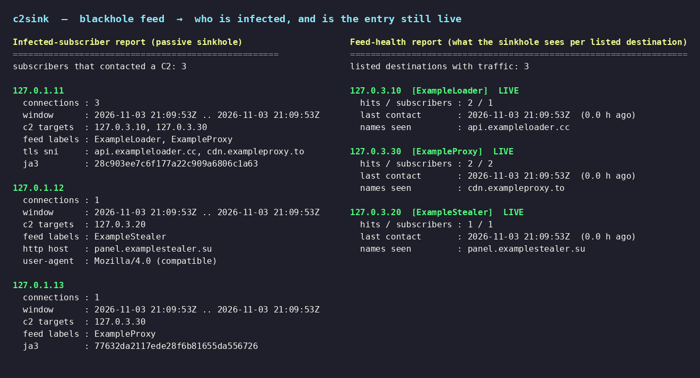

# c2sink

A blackhole feed tells you which IPs are bad and you drop the traffic to them.
That works, but you throw away everything the dropped packets could have told
you: whether those C2s are still active, what the infected machines look like,
and whether a prefix you're blackholing has started catching normal traffic by
mistake.

c2sink keeps that information. Instead of dropping traffic to a listed prefix,
you capture it, read the first few bytes each client sends, write down what you
saw, and never send anything back. It's the "C2 emulator" idea without actually
emulating a C2 — just a quiet collector for the traffic a blackhole normally
discards.



## Three layers, kept separate

The capture mechanism and the analysis are deliberately decoupled, so the same
engine works however the traffic reaches it:

- **Capture** — how you get the traffic. Three options, all feeding the same
  pipeline: replay a **pcap** (`c2sink ingest`, no setup at all); a live **TZSP**
  stream from a router mirroring the C2 routes; or the **live sink** that answers
  TCP handshakes for redirected traffic.
- **Protocol** — parse each first payload: TLS ClientHello (SNI, ALPN, JA4/JA3),
  HTTP request line, DNS query name, QUIC Initial. TCP is reassembled so a split
  ClientHello is put back together; UDP's first datagram is taken as the contact.
- **Intelligence** — feed health, beaconing, fingerprints, from the event log.

One caveat worth stating: a purely passive capture of blackholed TCP sees only
the SYNs — the client won't send its ClientHello until the handshake completes,
so for TCP something has to answer the SYN (and only that). UDP is fine as pure
capture; the first datagram already carries the payload. The live sink does the
minimal TCP handshake; the pcap/TZSP paths assume the capture point sees the
completed conversation (e.g. a mirror, or the sink's own traffic).

## Subscriber privacy

The client side of every connection is one of the operator's own subscribers,
so the source IP is the sensitive field. `--pseudonymize` replaces it with a
salted, keyed token (`anon:…`) *before* anything is written to disk, so a
feed-only deployment never records a real subscriber address; the token is
stable, so counts and beaconing still work, but it can't be read back without
the secret salt (pass it via `--salt-file` or `C2SINK_SALT`, never commit it).
The C2 address is kept in the clear — it's intelligence about an attacker, not
data about a person. The feed-health report (the view you'd share with the feed
operator) only ever reports a *count* of sources, never the addresses. Run the
live sink with `--user` so it drops root right after binding. The threat model,
and what these controls do and don't guarantee, is in `SECURITY.md`.

## What "passive" means here

The kernel completes the TCP handshake, because you can't read the first bytes
without it. After that the process does nothing: no reply, no C2 commands, no
tasking, no touching the device. It watches, it doesn't talk. There's an
end-to-end test that connects to the sink and checks it gets zero bytes back,
so that's not just a claim in a README.

It is not a takedown tool and it doesn't try to clean infected machines.

## What you get out of it

Each connection to a listed C2 is logged from the first read only — no
decryption, since the TLS ClientHello and the HTTP request line are both in the
clear. For TLS that's the SNI, ALPN, version and a JA4 and JA3 fingerprint
(GREASE stripped). The JA4 output matches FoxIO's reference vector (there's a
test for it). For HTTP it's the method, path, Host and User-Agent. If the
ClientHello was split across packets, that's noted rather than dropped.

The reports are built from that log, offline:

- **Feed health** — one row per feed entry, aggregated to the prefix (so a /24
  doesn't fan out into dozens of rows): hits, distinct sources, when it was last
  seen. If you pass the feed, entries that got *no* traffic show up too, marked
  as prune candidates — for a feed operator that's half the value. A row is
  "recently-seen" or "quiet"; it's about when traffic last hit the prefix, not a
  claim that the C2 server itself is up.
- **False-positive candidates** — a prefix getting hit by lots of different
  sources that are all asking for a real-looking hostname is probably catching
  legitimate traffic, and worth a second look before it causes an outage.
- **Beaconing** — pairs that call the same C2 on a steady timer. Malware checks
  in on a schedule; people don't.
- **Subscriber view** — which internal IP talked to which C2. Useful for an
  abuse desk, but only before CGNAT. If you already get this from NetFlow, skip
  it; the fingerprint and feed-health parts are the new bits.

Nothing is attributed beyond the label your feed already carries.

## Running it

Python 3.11+, standard library only (asyncio). The tests want `pytest` and
`pytest-asyncio`.

The quickest way to see it work needs no network and no root — replay the
sample capture that ships with the repo:

```sh
python -m c2sink ingest --pcap examples/sample_capture.pcap --feed examples/sample_feed.txt --log events.jsonl
python -m c2sink report --log events.jsonl --health --feed examples/sample_feed.txt
python -m c2sink report --log events.jsonl --beacons
```

To collect your own traffic, either point a router's TZSP mirror of the C2
routes at the sink host, or run the live sink and redirect the routes to it:

```sh
# run the sink (v4 + v6), appending to a JSONL log
python -m c2sink serve --feed examples/feed.txt --port 8443 --log events.jsonl

# get the C2 traffic to it, either:
#   a) REDIRECT the feed prefixes to the sink on this host
python -m c2sink rules --feed examples/feed.txt --port 8443 | sudo sh
#   b) or announce them into your network with this host as next-hop (ExaBGP,
#      no-export so it stays inside your AS)
python -m c2sink rules --feed examples/feed.txt --exabgp \
    --nh4 192.0.2.10 --nh6 2001:db8::10 --community 65000:666

# then read the log
python -m c2sink report --log events.jsonl --health --feed examples/feed.txt
python -m c2sink report --log events.jsonl --beacons
python -m c2sink report --log events.jsonl            # subscriber view
```

The feed file is one IP or CIDR per line, with an optional label:

```
203.0.113.0/24   Mirai
2001:db8:bad::/48 Emotet
198.51.100.10    # no label
```

Export your existing feed into that shape and you're done.

With Linux REDIRECT the sink recovers the real C2 address and port from
`SO_ORIGINAL_DST`, so one listener covers every prefix. With the ExaBGP
next-hop route the host receives the prefixes directly and the accept address
is the C2.

## Tests

```sh
PYTHONPATH=. python -m pytest -q
```

They cover the feed parsing and prefix lookup, the TLS parser (SNI, JA4/JA3,
GREASE, a truncated hello), HTTP parsing, rule generation, beacon detection,
and the end-to-end run that checks the sink stays silent.

## Known limits

- Only the first read is looked at; it never follows a conversation.
- Encrypted ClientHello hides the real SNI. You still see the outer name and
  that the connection happened; DNS-based controls are the fallback there.
- A ClientHello split across segments is recorded and flagged, not reassembled
  (yet).

## More detail

`ARCHITECTURE.md` has the component breakdown, why the sink sits before CGNAT,
how the original destination is recovered, and the failure modes. A full
captured run (real REDIRECT, three sources, three C2s) is in `examples/DEMO.md`;
`sudo ./examples/reproduce.sh` regenerates it.

This is a working prototype, not something that's been run against a live feed
yet.
